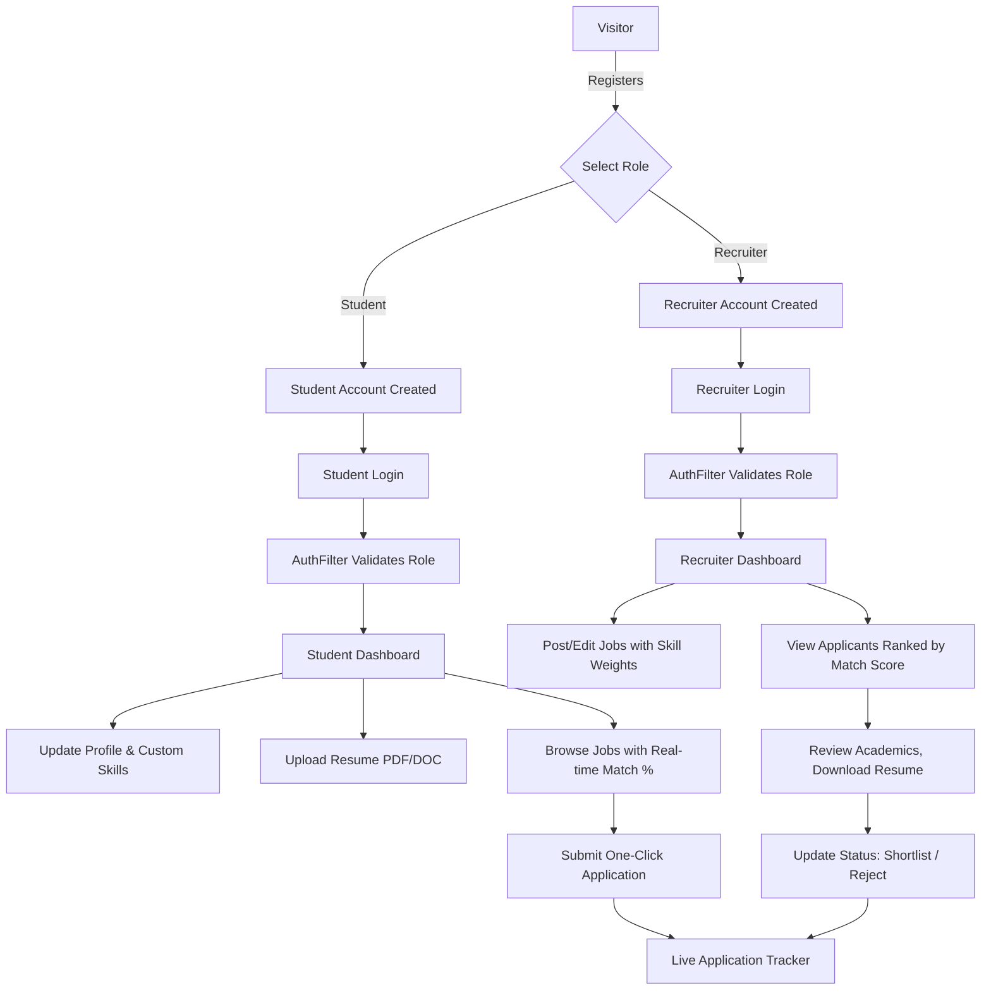

# SmartHire — Comprehensive Project Workflow & System Documentation

---

## 1. Executive Summary
**SmartHire** is an enterprise-grade recruitment and campus placement portal built using Jakarta EE (Servlets & JSP), MySQL, and native Java. The platform connects graduating students with hiring companies through an **Intelligent Skill-Weighted Matching Engine** that evaluates candidates based on mandatory skills, weighted nice-to-have skills, and academic CGPA thresholds.

---

## 2. Technology Stack

| Layer | Technology | Details |
|---|---|---|
| **Language** | Java 17 | Core backend application logic |
| **Web Framework** | Jakarta EE 10 (Servlet 6.0, JSP 3.1) | Clean Model-View-Controller (MVC) architecture |
| **Application Server** | Apache Tomcat 10.1.x | Deployed as standard `.war` archive |
| **Database** | MySQL 8.x | Normalized relational schema with foreign key constraints |
| **Database Access** | Native JDBC | PreparedStatements to prevent SQL injection, explicit transactions |
| **Security** | jBCrypt 0.4 | Salted BCrypt password hashing for zero plaintext storage |
| **Styling & UI** | Vanilla CSS3 + Modern Glassmorphism | Custom responsive layout, CSS variables, interactive tag pills |
| **Build Tool** | Apache Maven | Project lifecycle, dependency management, and compilation |

---

## 3. Database Architecture & Access

### Database Credentials
- **Host**: `127.0.0.1` (or `localhost`)
- **Port**: `3306`
- **Database Name**: `smarthire`
- **User**: `root`
- **Password**: `asa7053`

### Viewing Data in MySQL
To inspect the database via terminal:
```bash
mysql -h 127.0.0.1 -P 3306 -u root -pasa7053 smarthire
```

### Relational Schema Summary
```
+---------------+       +--------------------+       +--------------------+
|     users     | <---- |  student_profiles  |       | recruiter_profiles |
| (id, email,   |       | (user_id, cgpa,    |       | (user_id, company) |
|  role, hash)  |       |  degree, grad_yr)  |       +--------------------+
+---------------+       +--------------------+                 |
  |         |                      |                           |
  |         |                      v                           v
  |         |           +--------------------+       +--------------------+
  |         +---------> |   student_skills   |       |       jobs         |
  |                     | (student_id,       |       | (id, recruiter_id, |
  |                     |  skill_id)         |       |  title, min_cgpa)  |
  |                     +--------------------+       +--------------------+
  |                                |                           |
  |                                v                           v
  |                     +--------------------+       +--------------------+
  |                     |       skills       | <---- |     job_skills     |
  |                     | (id, name)         |       | (job_id, skill_id, |
  |                     +--------------------+       |  mandatory, weight)|
  |                                                  +--------------------+
  v                                                            |
+--------------------+                                         |
|    applications    | <---------------------------------------+
| (student_id,       |
|  job_id, score,    |
|  status)           |
+--------------------+
```

---

## 4. Test Credentials & Seed Accounts

All accounts below have been pre-seeded with the password: **`password123`**

### Recruiter Accounts
| Company Name | Contact Person | Email Address | Password |
|---|---|---|---|
| **Google India** | Ananya Sengupta | `recruiter.google@example.com` | `password123` |
| **Microsoft India** | Vikram Malhotra | `recruiter.msft@example.com` | `password123` |
| **Amazon AWS** | Kavita Krishnan | `recruiter.amazon@example.com` | `password123` |
| **Apex Technologies** | Demo Recruiter | `recruiter_test@smarthire.com` | `password123` |
| **LTM** | Ayushi | `ayushi760@gmail.com` | `password123` |

### Student Accounts
| Student Name | Degree & Year | CGPA | Core Skills | Email Address | Password |
|---|---|---|---|---|---|
| **Rahul Sharma** | B.Tech CSE (2026) | 8.75 | Java, SQL, MySQL, Spring Boot, Git | `rahul.sharma@example.com` | `password123` |
| **Priya Patel** | B.Tech IT (2026) | 9.10 | React, JavaScript, HTML, CSS, SQL | `priya.patel@example.com` | `password123` |
| **Rohan Verma** | MCA (2027) | 7.90 | Python, SQL, AI/ML, RAG, LangChain | `rohan.verma@example.com` | `password123` |
| **Sneha Nair** | B.E. ECE (2026) | 8.30 | Java, SQL, MySQL, JDBC, CSS | `sneha.nair@example.com` | `password123` |
| **Ayushi** | MCA (2027) | 9.00 | Java, SQL, AI/ML, RAG, LangChain | `ayushi7607053@gmail.com` | `password123` |

---

## 5. End-to-End System Workflows



### Workflow 1: Authentication & Authorization Security
1. **User Registration (`/register`)**:
   - Accepts Full Name, Email, Password, and Role (`STUDENT` or `RECRUITER`).
   - If `RECRUITER`, collects the Company Name.
   - Checks if email already exists via `UserDAO.existsByEmail()`.
   - Hashes password with `BCrypt.hashpw(plainPassword, BCrypt.gensalt())`.
   - Creates `users` record and corresponding `student_profiles` or `recruiter_profiles` in a database transaction.
2. **User Login (`/login`)**:
   - Queries user by email.
   - Verifies password using `BCrypt.checkpw(password, user.getPasswordHash())`.
   - On success, sets `session.setAttribute("user", user)` and `session.setAttribute("role", user.getRole())`.
   - Redirects students to `/student/dashboard` and recruiters to `/recruiter/dashboard`.
3. **Role Authorization Filter (`AuthFilter`)**:
   - Intercepts all requests matching `/student/*` and `/recruiter/*`.
   - If not logged in $\rightarrow$ redirects to `/login`.
   - If a student tries to access `/recruiter/*` $\rightarrow$ sends `HTTP 403 Forbidden`.
   - If a recruiter tries to access `/student/*` $\rightarrow$ sends `HTTP 403 Forbidden`.
4. **User Logout (`/logout`)**:
   - Calls `session.invalidate()` and redirects to `/login`.

---

### Workflow 2: Student End-to-End Journey
1. **Login & Dashboard Overview**:
   - Views statistics: Total Applied, Under Review, Shortlisted, Rejected.
   - Views top recommended jobs based on their skills.
2. **Profile & Skill Management (`/student/profile`)**:
   - Enters Education (e.g. B.Tech), Graduation Year (e.g. 2026), CGPA (e.g. 8.75), Summary, and Experience.
   - **Predefined Skills**: Selects common skills (Java, SQL, MySQL, HTML, etc.) from checkboxes.
   - **Custom Skills**: Types any new specialized skill (e.g. "LangChain", "Docker", "PyTorch") and presses Enter/comma.
   - On submit, `SkillDAO.insertIfNotExists()` automatically registers any unknown skills in the database and links them to the student.
3. **Resume Upload (`/student/resume`)**:
   - Uploads a PDF or DOC/DOCX resume file (validated up to 10MB).
   - `ResumeServlet` saves the physical file in a dedicated upload directory and stores file metadata in `resumes`.
   - Student can view upload timestamp and download their stored resume at any time.
4. **Job Search & Discovery (`/student/jobs`)**:
   - Filters jobs by keyword, title, location, or company name.
   - For every listed job, the system computes and renders a **Smart Match Score Badge** (e.g. "92% Match - High Match").
5. **Job Detail & Application (`/student/job-detail?id=X`)**:
   - Reads full job description, location, employment type, and required skills breakdown.
   - Clicks **"Apply Now"** $\rightarrow$ `StudentApplyServlet` checks for duplicate applications, computes the final match score, and records the application under `applications` with initial status `APPLIED`.
6. **Application Tracking (`/student/applications`)**:
   - Tracks live application status badges (`APPLIED`, `UNDER_REVIEW`, `SHORTLISTED`, `REJECTED`).

---

### Workflow 3: Recruiter End-to-End Journey
1. **Recruiter Dashboard (`/recruiter/dashboard`)**:
   - Overview cards: Active Jobs, Total Applicants, Shortlisted, Under Review.
   - Table of all posted jobs with links to edit or view applicants.
2. **Posting a Job (`/recruiter/job-create`)**:
   - Enters Job Title, Description, Location, Employment Type (Full-time, Internship, Contract), and Minimum CGPA.
   - Selects required skills from checkboxes, marking whether each is **Mandatory** and setting its **Weight** (1 to 5).
   - Enters **Custom Required Skills** via tag pills.
   - Submits form $\rightarrow$ `JobDAO.insert()` creates the job and `SkillDAO.updateJobSkills()` maps the skill requirements.
3. **Applicant Review & Screening (`/recruiter/applicants?jobId=X`)**:
   - Displays all candidate applications ranked in descending order of **Match Score**.
   - Displays candidate details: Full Name, Email, CGPA, Degree, Graduation Year, Experience.
   - Recruiter can click **"Download Resume"** to inspect the student's CV directly.
   - Recruiter selects a new status from the dropdown (`UNDER_REVIEW`, `SHORTLISTED`, `REJECTED`) and clicks **Update**.

---

### Workflow 4: The Intelligent Matching Engine (`MatchService`)

```
Match Score = (Skill Match Component * 0.70) + (CGPA Component * 0.30)
```

1. **Mandatory Skills Verification**:
   - If the job defines mandatory skills (e.g., Java is required) and the student does NOT possess one or more mandatory skills, a severe penalty (50% reduction) is applied to the overall score.
2. **Weighted Skill Match (70% weight)**:
   $$\text{Skill Score} = \frac{\sum \text{Weights of Matching Skills}}{\sum \text{Weights of All Required Skills}} \times 100$$
3. **Academic CGPA Match (30% weight)**:
   - If Student CGPA $\ge$ Job Minimum CGPA: Student receives 100% of the academic component.
   - If Student CGPA $<$ Job Minimum CGPA: Scaled proportionally:
     $$\text{CGPA Score} = \left(\frac{\text{Student CGPA}}{\text{Min CGPA}}\right) \times 100$$
4. **Final Clamping**:
   - Score is clamped between $0.0\%$ and $100.0\%$ and formatted to 1 decimal place.

---

## 6. Complete File-by-File Breakdown

### Models (`src/main/java/com/smarthire/model/`)
- `User.java`: Stores user ID, full name, email, BCrypt password hash, user role (`STUDENT`, `RECRUITER`, `ADMIN`), and creation timestamp.
- `StudentProfile.java`: Encapsulates student education details, graduation year, CGPA, career summary, and prior experience.
- `RecruiterProfile.java`: Encapsulates recruiter company name and company description.
- `Job.java`: Represents a job posting including recruiter ID, title, description, location, employment type, min CGPA, active status, and posted date.
- `Skill.java`: Represents an individual skill ID and skill name.
- `Application.java`: Represents an application linkage between a student and a job, with match score, status, and application timestamp.
- `Resume.java`: Represents resume metadata (original filename, storage filename, full file path, upload timestamp).

### Data Access Objects (`src/main/java/com/smarthire/dao/`)
- `UserDAO.java`: Performs user queries (lookup by email, lookup by ID, insertion with BCrypt hash, duplicate email checks).
- `StudentProfileDAO.java`: Fetches and upserts student profile records in `student_profiles`.
- `RecruiterProfileDAO.java`: Fetches and upserts recruiter company records in `recruiter_profiles`.
- `JobDAO.java`: Manages job CRUD operations (insert, update, findById, findAllActive, findByRecruiterId, keyword search).
- `SkillDAO.java`: Manages skill lookups, `student_skills` and `job_skills` junction tables, and `insertIfNotExists()` for custom tags.
- `ApplicationDAO.java`: Handles application creation, student application history, recruiter applicant listings, status updates, and duplicate checks.
- `ResumeDAO.java`: Manages resume records in `resumes` table.

### Servlets / Controllers (`src/main/java/com/smarthire/servlet/`)
- `HomeServlet.java` (`/`): Routes root requests to either the student dashboard, recruiter dashboard, or public landing page.
- `LoginServlet.java` (`/login`): Validates user login credentials against BCrypt hashes and establishes session state.
- `RegisterServlet.java` (`/register`): Handles dual student/recruiter registration with validation and duplicate prevention.
- `LogoutServlet.java` (`/logout`): Destroys HTTP session and redirects to login.
- `StudentDashboardServlet.java` (`/student/dashboard`): Computes dashboard metrics and recommends top jobs.
- `StudentProfileServlet.java` (`/student/profile`): Reads and saves student academic info and predefined + custom skills.
- `StudentJobsServlet.java` (`/student/jobs`): Search and browse all active jobs with live match percentages.
- `StudentApplyServlet.java` (`/student/apply`): Computes real-time match score and submits job application.
- `StudentApplicationsServlet.java` (`/student/applications`): Displays status of all jobs applied by the student.
- `ResumeServlet.java` (`/student/resume`): Multipart file upload handling for resumes and binary file streaming for download.
- `RecruiterDashboardServlet.java` (`/recruiter/dashboard`): Aggregates recruiter statistics and lists recruiter's active jobs.
- `JobCreateServlet.java` (`/recruiter/job-create`): Handles creation of new jobs with skill weights and custom tags.
- `JobEditServlet.java` (`/recruiter/job-edit`): Handles modification of existing job postings and required skills.
- `ApplicantReviewServlet.java` (`/recruiter/applicants`): Displays candidate applications ranked by match score and updates review status.
- `RecruiterProfileServlet.java` (`/recruiter/profile`): Manages company profile updates.

### Filters & Services (`src/main/java/com/smarthire/filter/`, `service/`, `util/`)
- `AuthFilter.java`: Enforces role-based access control on `/student/*` and `/recruiter/*` URLs.
- `MatchService.java`: Evaluates student profile vs job requirements to produce a 0–100% score.
- `DBConnection.java`: JDBC connection provider supporting environment variables and local fallback.
- `DatabaseUtil.java`: Convenience wrapper around `DBConnection`.

### Web Views (`src/main/webapp/WEB-INF/jsp/`)
- `common/header.jsp`: Dynamic global navigation bar with active role-based links and user greeting.
- `common/footer.jsp`: Consistent footer branding and copyright.
- `auth/login.jsp`: Modern login page with error alerts and links to register.
- `auth/register.jsp`: Dual-tab registration interface for students and recruiters.
- `student/dashboard.jsp`: Student summary dashboard with metric cards and recommended jobs.
- `student/profile.jsp`: Academic profile form with checkbox skills and custom skill tag input.
- `student/jobs.jsp`: Job directory with search bar, location filters, and match badges.
- `student/job_detail.jsp`: Comprehensive job overview with match percentage badge and one-click apply.
- `student/applications.jsp`: Student application tracking table with colored status badges.
- `student/resume.jsp`: File upload drag-and-drop zone and download resume button.
- `recruiter/dashboard.jsp`: Recruiter statistics dashboard with action buttons to post and manage jobs.
- `recruiter/job_form.jsp`: Job posting/editing form with skill weights and custom tag pills.
- `recruiter/applicants.jsp`: Candidate leaderboard sorted by match score with status change dropdowns.
- `recruiter/profile.jsp`: Recruiter company profile form.

---

## 7. How to Build and Run the Project

### 1. Build WAR File
From the project root:
```bash
mvn clean package -DskipTests
```
This produces `target/SmartHire.war`.

### 2. Deploy to Apache Tomcat
Copy the generated WAR file into your Tomcat `webapps/` folder:
```bash
cp target/SmartHire.war /Users/ayushi/Documents/ApacheTomcat/apache-tomcat-10.1.61/webapps/SmartHire.war
```

### 3. Access in Browser
- **Home / Landing**: [http://localhost:8080/SmartHire/](http://localhost:8080/SmartHire/)
- **Login**: [http://localhost:8080/SmartHire/login](http://localhost:8080/SmartHire/login)
- **Register**: [http://localhost:8080/SmartHire/register](http://localhost:8080/SmartHire/register)
